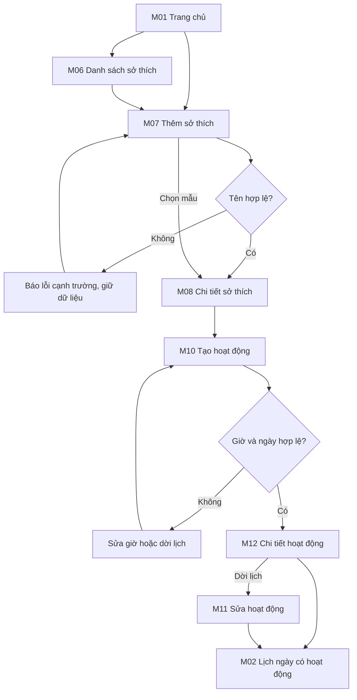
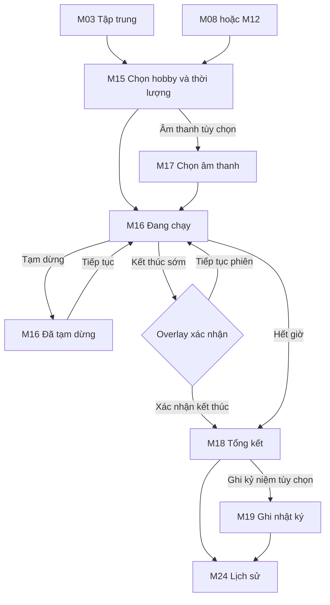
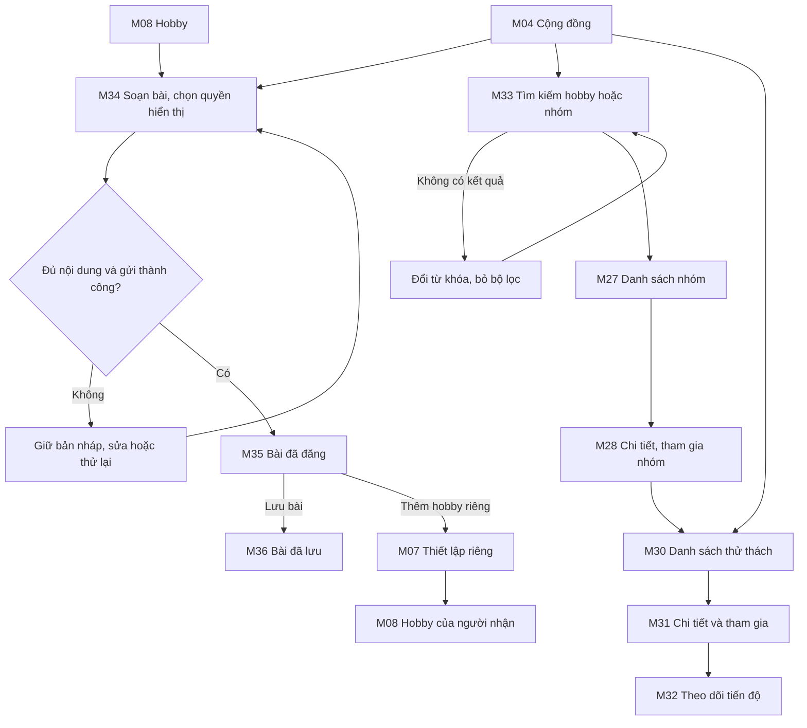

# Information architecture và ba user flow

Ngày chốt: 11/10/2026. Theo yêu cầu mới: F1 lịch/hobby, F2 Focus, F3 cộng đồng.

## Cấu trúc điều hướng

5 điểm đến cấp cao: M01 Trang chủ, M02 Lịch trình, M03 Tập trung, M04 Cộng đồng, M05 Cá nhân. Mỗi màn con có Back về màn nguồn hoặc màn cha. M00 là quy chuẩn, không tính vào 44 màn hình chức năng.

| Cấp cao | Màn con | Vai trò |
|---|---|---|
| M01 Trang chủ | M14; đường tắt đến M06/M07, M10, M03 và M04 | Điểm vào F1, gợi ý và tiến độ |
| M02 Lịch trình | M06–M13 | Hobby và hoạt động theo ngày |
| M03 Tập trung | M15–M24 | Phiên Focus, nhật ký và tiến độ |
| M04 Cộng đồng | M25–M37 | Bài chia sẻ, tìm nhóm và thử thách |
| M05 Cá nhân | M38–M44 | Hồ sơ, cài đặt, thông báo, quyền riêng tư |

M01–M44 là danh mục hiện có. Màn cá nhân dùng chung để hỗ trợ cả 3 flow. Kiến thức, album, thảo luận sâu và kết nối nhạc là nhánh mở rộng, không chiếm thời lượng demo chính.

## F1 — Từ Home tạo hobby và theo dõi lịch ngày

**Bắt đầu:** M01. **Mục tiêu:** Minh tạo Guitar, mục tiêu 30 phút/ngày và lịch luyện tập. **Kết thúc:** M02 có hoạt động đúng ngày/giờ. Tiêu chí thiết kế: ≥80% hoàn thành trong ≤3 phút, chưa có số liệu thực nghiệm.

Happy path: M01 → M07 → M08 → M10 → M12 → M02. Alternate: M01 → M06 → chọn hobby đã có → M08. Error/recovery: thiếu tên/giờ không hợp lệ → thông báo cụ thể → sửa và lưu. Validation ngày/giờ là đặc tả cần kiểm chứng, HTML hiện chỉ chắc chắn có kiểm tra trường bắt buộc khi đọc mã.

## F2 — Tạo phiên Focus cho hobby

**Bắt đầu:** M03 hoặc M08/M12. **Mục tiêu:** tập trung 25 phút cho Guitar, có thể bị gián đoạn. **Kết thúc:** M18 và xem lại M24. Tiêu chí: ≥80% bắt đầu trong ≤60 giây, Pause/Resume trong ≤15 giây. Đây là mục tiêu.

Không cộng thời gian Pause. Kết thúc sớm ghi thời gian thực tế, mỗi session chỉ lưu một lần. Quy tắc này là handoff đích, HTML nguồn còn tổng kết mẫu và chưa chứng minh tính đúng.

## F3 — Chia sẻ hobby, tìm/tham gia cộng đồng và thử thách

**Bắt đầu:** M04 hoặc M08. **Mục tiêu:** Minh chia sẻ hobby, An tìm cộng đồng phù hợp và tham gia thử thách. **Kết thúc:** bài M35, nhóm M28 đã tham gia và thử thách M32 có tiến độ. Đây là một flow cấp cao có ba nhánh nhiệm vụ, cần demo đủ nhánh người dùng yêu cầu.

Bài public chỉ gồm phần người dùng chủ động chia sẻ. Không sao chép lịch, nhật ký, phiên Focus của tác giả. Search → kết quả bài hoặc nhóm → mở đúng loại chi tiết. Nếu đã tham gia thì đổi CTA thành “Đã tham gia / Theo dõi”, không đăng ký lần hai. Chưa có bằng chứng dữ liệu nhiều tài khoản thật.

## Mapping flow–screen

| Flow | Core bắt buộc demo | Nhánh thay thế/hỗ trợ |
|---|---|---|
| F1 | M01, M07, M08, M10, M12, M02 | M06, M09, M11, M13, M14 |
| F2 | M03, M15, M16, M18, M24 | M08/M12, M17, M19–M23 |
| F3 | M04, M34, M35, M33, M27, M28, M30–M32 | M07/M08, M25/M26, M29, M36/M37 |
| Hỗ trợ chung | M05, M38–M44 | Hồ sơ, quyền riêng tư, thông báo và hướng dẫn phục vụ F1–F3 |

## Quy tắc prototype cần thực hiện trong Figma

3 starting point: `F1_Home_Hobby_Calendar`, `F2_Hobby_Focus`, `F3_Community_Share_Join`. Overlay M16 xác nhận kết thúc phải có nút tiếp tục/đóng. Trạng thái posting loading → M35 dùng frame/state riêng, after delay hoặc tương tác mô phỏng rõ ràng. Không dùng nút chuyển màn của công cụ HTML làm bằng chứng wiring Figma. Không gán dialog hay 5 trạng thái M16 thành 5 màn hình chức năng riêng.

Figma target có đúng các page: 01 User Flow; 02 Wireframe; 03 Final UI; 04 Design System; 05 Components; 06 Prototype. A–E đặt thành Section bên trong Final UI. Đây là yêu cầu đích, khác với 5 page đang tồn tại.
